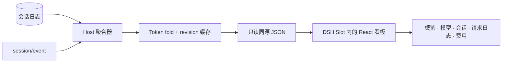

<p align="center"><a href="./README.md"><strong>中文</strong></a> · <a href="./README.en.md">English</a></p>

<p align="center">
  
</p>

<h1 align="center">dsh-token-dashboard</h1>

<p align="center"><strong>为每个 DeepSeek Harness 会话提供用量、费用与请求延迟。</strong></p>

<p align="center">一个本地优先的 Cordis 插件，把本地 DSH 会话历史变成原生看板。</p>

<p align="center">
  
  
  
  
  
</p>

<p align="center">
  <a href="#功能">功能</a> ·
  <a href="#快速开始">快速开始</a> ·
  <a href="#使用">使用</a> ·
  <a href="#架构">架构</a> ·
  <a href="#开发">开发</a>
</p>

---

## 概览

DSH 已经能显示当前会话的 Token 用量，但看不到完整视图：所有项目、模型、子代理、分叉和请求分散在各个会话里。

`@shi-yangyang/dsh-token-dashboard` 补上的就是这一层，以 **Token 用量** 的形式作为原生插件运行。

Host 端通过官方 `sessionPersistence` 服务读取会话日志，并使用与 `@deepseek-ai/dsh-token-meter` 一致的四桶口径折叠数据。Client 端通过 DSH Slot 注册 `main` 面板和侧边栏 footer 入口，使用宿主提供的 React 运行时和主题 Token 渲染。

插件不会写入会话日志、修改模型请求或上传会话数据。会话日志始终是唯一事实来源。

## 功能

- **全局用量视图**：当前 profile 下所有会话的总量、未缓存输入、输出、缓存读/写、请求数、缓存命中率和会话数。
- **时间范围联动**：今天、最近 7 / 30 / 90 天、全部时间或自定义日期范围；KPI 与 Usage 图表使用同一范围。
- **模型与会话**：可搜索、筛选、排序的分页表格，以及会话详情抽屉。
- **请求日志**：按每次计费请求展示时间、应用、供应商、模型、新增输入、输出、缓存命中、成本、速度和首字耗时。
- **费用估算**：内置 357 个 OpenRouter 模型快照与 DeepSeek 高峰价；可本地覆盖任意单价，也可按需从 OpenRouter 刷新。
- **原生与本地优先**：DSH Slot、主题 Token、中英文界面、同源只读路由；导出时自动去掉工作目录。

## 快速开始

本项目包名为 **`@shi-yangyang/dsh-token-dashboard`**。当前请按下文从源码构建并作为本地 bundle 安装。npm 上不带 scope 的 `dsh-token-dashboard` 属于另一个项目，请勿使用 `npm install dsh-token-dashboard` 安装本插件。

### 环境要求

- 可运行 Web UI 的 DeepSeek Harness。已在 DSH Desktop `0.2.1-rc.3`（Cordis `4.0.5`）验证。
- 从源码构建需要 Node.js **22.18 或更高版本** 和 `pnpm`。

### 构建

```bash
git clone https://github.com/shi-YangYang/dsh-token-dashboard.git
cd dsh-token-dashboard
pnpm install
```

`pnpm install` 会通过 `prepare` 自动构建 Host 和 Client，生成不入库的 `lib/` 和 `client/`。修改源码后可运行 `pnpm build` 重新构建。

### 安装到 DSH

在 DSH 的 **Plugins** 界面中选择本地 bundle 安装，目标指向本目录；也可以在 DSH Agent 中执行：

```text
plugin_manager(action: "install_bundle", target: "/absolute/path/to/dsh-token-dashboard")
```

如果 profile 中禁用了该 bundle，请启用，然后刷新 DSH Web 页面。在侧边栏底部、Settings 上方打开 **Token 用量**。

更新 Host 代码后需要重启 DSH；仅修改 Client 时刷新页面即可。

## 使用

| 页面 | 内容 |
| --- | --- |
| **概览** | 所选范围内的全局 KPI 与 Usage 图表 |
| **模型** | 按供应商/模型统计的 Token 分布与请求数 |
| **会话** | 搜索、筛选、排序、分页和会话详情 |
| **请求日志** | 逐条计费请求，每页 12 条，最新在前 |
| **费用** | 预估总费用、逐模型明细、单价覆盖与在线价目刷新 |

顶部提供语言切换、扫描间隔、**立即同步**和导出。扫描间隔控制本地会话轮询：**5 / 10 / 30 / 60 秒**。所有列表每页最多 **12 行**，行高保持紧凑，分页位于卡片底部，不引入卡片或表格滚动条。

请求日志的成本按浏览器中的当前价目即时计算，未定价模型显示 `—`。速度 = 输出 Token / 实测请求窗口；首字 = `step/start` 到首个 stream record 的时间，没有 stream 时间戳时显示 `—`。

费用只是估算，不是 provider 账单。内置 DeepSeek 单价为高峰价，非高峰约为一半。单价覆盖和在线价目缓存保存在浏览器 `localStorage`。

## 架构



- **Host**（`src/host`）读取官方会话存储、增量折叠用量、处理价目并提供看板 API。缓存只在内存中，按会话 revision 或 live sequence 维护；没有第二个数据库或账本。
- **Client**（`src/client`）注册 `main` 与 `sidebar.footer.action` Slot，管理扫描间隔、语言和价目偏好，并渲染看板。React 由宿主提供，不会重复打包。
- **Shared**（`src/shared`）包含双方共用的 wire 类型、四桶运算、范围选择、价目和格式化。

统计遵循 `tokenUsage` 的公开口径：四个互斥 provider 桶、同一次 attempt 的最终样本替换流式样本、重试开启新 attempt、分叉继承的前缀不计入总量。实现见 [`src/host/fold.ts`](./src/host/fold.ts)。

HTTP 接口只读且同源：

| 路由 | 用途 |
| --- | --- |
| `GET /dsh-token-dashboard/stats` | 看板数据；支持 ETag/`304` 与 `?refresh=1` |
| `GET /dsh-token-dashboard/requests` | 分页请求日志；`?offset=0&limit=24` |
| `GET /dsh-token-dashboard/prices` | 可选 OpenRouter 在线价目；`?models=a,b&refresh=1` |
| `GET /dsh-token-dashboard/health` | 存活状态、API 版本和当前 revision |
| `GET /dsh-token-dashboard/verify` | 与官方 `tokenUsage` 投影的诊断对比 |

存在 Host Connection 时，所有路由都会复用其鉴权，并返回 `Cache-Control: no-store`；只有 `/stats` 带弱 ETag。接口不会暴露 prompt、assistant 文本、工具参数、凭据或文件内容。

## 开发

```bash
pnpm install
pnpm build        # Host（tsc）+ Client（esbuild）
pnpm typecheck    # Host、Client、Test 三套类型检查
pnpm test         # 87 个测试：单元、路由、SSR、jsdom、bundle
pnpm verify:real  # 用独立实现校验真实本地日志折叠
pnpm build:prices # 刷新 OpenRouter 内置价目快照（需要网络）
```

`pnpm verify:real` 需要已构建产物和本地会话日志；修改 fold 时优先运行它。

```text
src/host      会话源、Token fold、聚合、价目、HTTP 路由
src/client    React 界面、DSH Slot、hooks、主题 Token 样式
src/shared    wire 类型、价目、范围、格式化
test          node:test 测试与 SSR/jsdom 渲染检查
scripts       构建、测试、真实会话校验
```

## 贡献

欢迎提交 Issue 和 Pull Request。提交前请运行 `pnpm typecheck` 与 `pnpm test`；行为变更请补充回归测试，并保持只读、不上传数据的边界。

## 已知限制

- 只覆盖当前 DSH profile 的本地会话存储；远程、云端和其他 profile 的会话不包含在内。
- 首次打开会把历史扫描进内存缓存。DSH 重启后缓存清空，没有持久化索引。
- 请求速度和首字依赖日志中的 stream 时间戳；旧日志或没有 stream 的请求显示 `—`。
- 费用是以 USD 计的列表价估算，不是账单。内置快照日期为 **2026-10-30**；在线刷新和用户覆盖会改变估算结果。
- 会话跳转依赖可选的 `uiWorkspace.openSession` 宿主服务。

## 许可证

[MIT](./LICENSE) © 2026 小洋

为 DeepSeek Harness 与 Cordis 构建。价目数据来自公开的 OpenRouter 模型列表和 DeepSeek 公布的单价。
