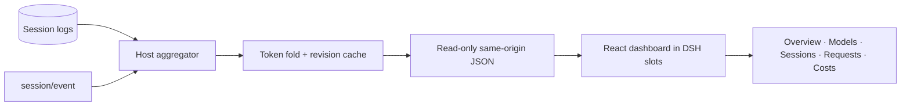

<p align="center">
  
</p>

<h1 align="center">dsh-token-dashboard</h1>

<p align="center"><strong>Usage, cost, and request latency for every DeepSeek Harness session.</strong></p>

<p align="center">A local-first Cordis plugin that turns local DSH session history into a native dashboard.</p>

<p align="center">
  
  
  
  
  
</p>

<p align="center">
  <a href="#features">Features</a> ·
  <a href="#quick-start">Quick start</a> ·
  <a href="#usage">Usage</a> ·
  <a href="#architecture">Architecture</a> ·
  <a href="#development">Development</a>
</p>

---

## Overview

DSH already shows token usage for the session in front of you. It does not show the whole picture: every project, model, subagent, fork, and request across your local history.

`dsh-token-dashboard` adds that missing layer as a native plugin, displayed as **Token usage** in DSH.

The Host half reads session logs through the official `sessionPersistence` service and folds them with the same four-bucket accounting used by `@deepseek-ai/dsh-token-meter`. The Client half registers a `main` panel and a sidebar-footer entry using DSH slots, then renders with the host React runtime and theme tokens.

The plugin never writes a session log, changes a model request, or uploads session data. The logs remain the only source of truth.

## Features

- **Global usage in one view** — totals, uncached input, output, cache read/write, request count, cache hit rate, and session counts across all sessions in the active profile.
- **Range-aware trends** — today, last 7 / 30 / 90 days, all time, or a custom date range; KPIs and the Usage chart share the same range.
- **Models and sessions** — searchable, filterable, sortable tables with pagination and a session detail drawer.
- **Request log** — one row per billed request, with time, app, provider, model, new input, output, cache hit, cost, speed, and first-token latency.
- **Cost estimates** — a built-in 357-model OpenRouter snapshot plus hand-maintained DeepSeek peak rates; override any price locally, or refresh from OpenRouter on demand.
- **Native and local-first** — DSH slots, DSH theme tokens, English/中文 UI, same-origin read-only routes, and exports that strip the working directory.

## Quick start

### Requirements

- A DeepSeek Harness installation with the Web UI. Verified on DSH Desktop `0.2.1-rc.3` (Cordis `4.0.5`).
- Node.js **22.18 or newer** and `pnpm` when building from source.

### Build

```bash
git clone https://github.com/shi-YangYang/dsh-token-dashboard.git
cd dsh-token-dashboard
pnpm install
pnpm build
```

`lib/` and `client/` are build outputs and are not committed. Build before installing the plugin.

### Install into DSH

Install this directory as a local bundle from DSH's **Plugins** interface, or from a DSH agent:

```text
plugin_manager(action: "install_bundle", target: "/absolute/path/to/dsh-token-dashboard")
```

Enable the bundle if your profile has it disabled, then refresh the DSH Web page. Open **Token usage** from the sidebar footer, above Settings.

Updating Host code requires a DSH restart; Client-only changes need a page refresh.

## Usage

| Page | What it shows |
| --- | --- |
| **Overview** | Global KPIs and a Usage chart across the selected range |
| **Models** | Token distribution and request counts by provider/model |
| **Sessions** | Search, filters, sorting, pagination, and per-session detail |
| **Request log** | Individual billed requests, 12 per page, newest first |
| **Costs** | Estimated spend, per-model breakdown, pricing overrides, and online price refresh |

The header provides the language switch, scan interval, **Sync now**, and export. Scan interval controls local session polling: **5 / 10 / 30 / 60 seconds**. All list tables share a 12-row page size with compact natural row heights; pagination stays at the footer and no list introduces an inner scrollbar.

Request-log cost is calculated with the current pricing table in the browser; unpriced models show `—`. Speed is output tokens divided by the measured request window. First-token latency runs from `step/start` to the first stream record; requests without stream timing show `—`.

Prices are estimates, not provider invoices. The built-in DeepSeek rates are peak-hour prices; off-peak rates are approximately half. Overrides and online price cache live in the browser's `localStorage`.

## Architecture



- **Host** (`src/host`) reads the official session store, folds usage incrementally, handles pricing, and serves the dashboard API. The cache is in memory and keyed by session revision (or live sequence); there is no second database or ledger.
- **Client** (`src/client`) registers `main` and `sidebar.footer.action` slots, manages scan/language/price preferences, and renders the dashboard. React is supplied by the host and is not bundled twice.
- **Shared** (`src/shared`) contains the wire types, four-bucket arithmetic, range selection, pricing, and formatting used by both sides.

Usage follows the published `tokenUsage` semantics: four disjoint provider buckets, final samples replacing stream samples for the same attempt, retries opening a new attempt, and inherited fork prefixes excluded from totals. See [`src/host/fold.ts`](./src/host/fold.ts) for the implementation.

The HTTP surface is read-only and same-origin:

| Route | Purpose |
| --- | --- |
| `GET /dsh-token-dashboard/stats` | Dashboard payload; supports ETag/`304` and `?refresh=1` |
| `GET /dsh-token-dashboard/requests` | Paginated request log; `?offset=0&limit=24` |
| `GET /dsh-token-dashboard/prices` | Optional OpenRouter prices; `?models=a,b&refresh=1` |
| `GET /dsh-token-dashboard/health` | Liveness, API version, and current revision |
| `GET /dsh-token-dashboard/verify` | Diagnostic comparison with the official `tokenUsage` projection |

All routes use the Host Connection gate when available and return `Cache-Control: no-store`; `/stats` is the only route with a weak ETag. No prompts, assistant text, tool arguments, credentials, or file contents are exposed.

## Development

```bash
pnpm install
pnpm build        # Host (tsc) + Client (esbuild)
pnpm typecheck    # Host, Client, and Test type checks
pnpm test         # 87 tests: unit, routes, SSR, jsdom, bundle
pnpm verify:real  # fold real local logs against an independent reference
pnpm build:prices # refresh the generated OpenRouter price snapshot (network)
```

`pnpm verify:real` requires built artifacts and local session logs; it is the best check when changing the fold.

```text
src/host      session source, token fold, aggregation, prices, HTTP routes
src/client    React UI, DSH slots, hooks, theme-token styles
src/shared    wire types, pricing, ranges, formatting
test          node:test suites plus SSR/jsdom rendering checks
scripts       build, test, and real-session verification
```

## Contributing

Issues and pull requests are welcome. Run `pnpm typecheck` and `pnpm test` before submitting; include a regression test for behavior changes and preserve the read-only, no-upload data contract.

## Limitations

- Covers the active DSH profile's local session store only; remote, cloud, and other-profile sessions are not included.
- The first dashboard open scans history into an in-memory cache. A DSH restart starts fresh; there is no persistent index.
- Request speed and first-token latency depend on recorded stream timestamps. Older logs, or requests without streams, show `—`.
- Cost is a list-price estimate in USD, not a bill. The built-in snapshot is dated **2026-10-30**; online refresh and user overrides can change the displayed estimate.
- Session navigation depends on the optional `uiWorkspace.openSession` host service.

## License

[MIT](./LICENSE) © 2026 小洋

Built for DeepSeek Harness and Cordis. Pricing data comes from the public OpenRouter model list and DeepSeek's published rates.
